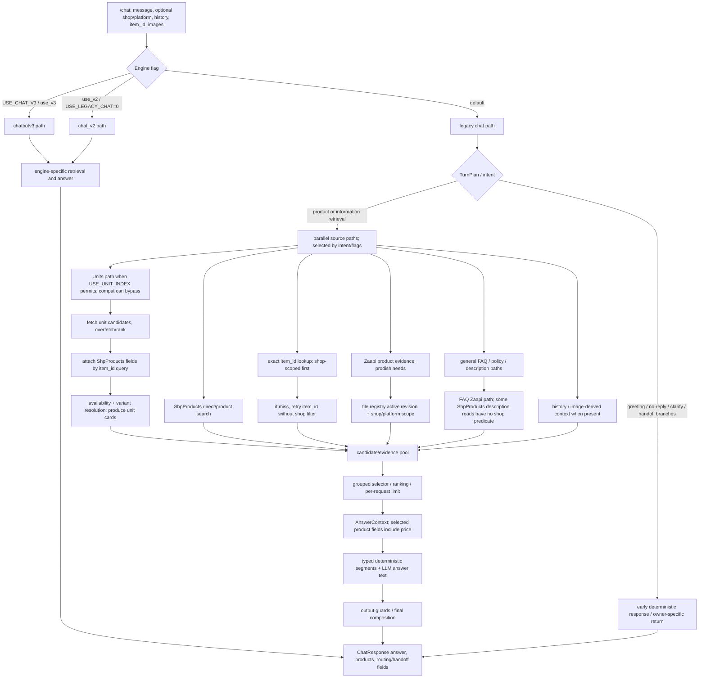
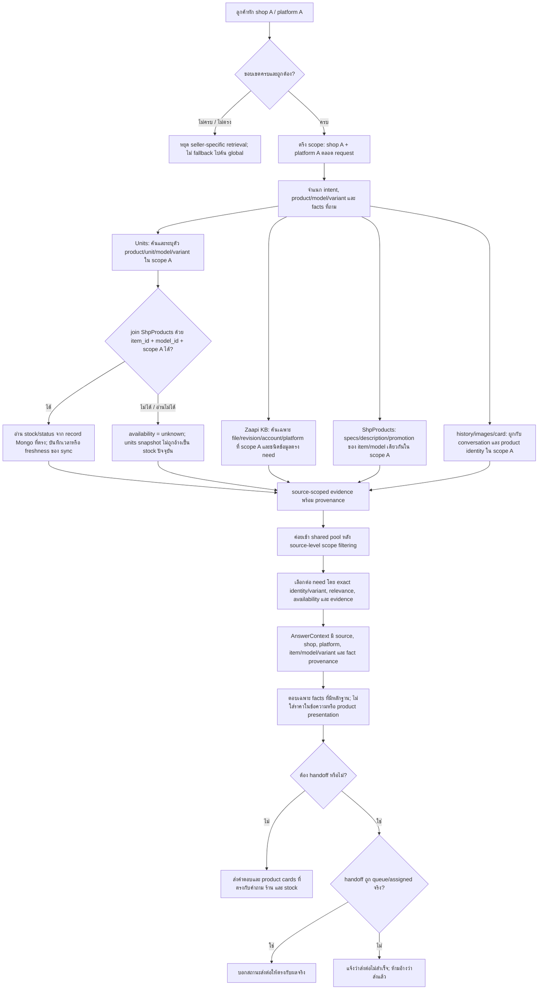

# Customer Answer Audit — Raw Findings

วันที่บันทึก: 2026-11-11 (Asia/Bangkok)
ชนิดเอกสาร: รายงานหลักฐานดิบและรายการสิ่งที่พบ ไม่ใช่บทสรุปผู้บริหาร ไม่ใช่แผนแก้ไข
ขอบเขต: transcript ที่ผู้ใช้แนบ, โครงสร้างเก็บและค้นข้อมูล Zaapi/product, เส้นทางประกอบคำตอบ, ผลตรวจ Mongo แบบอ่านอย่างเดียวและ test runs ที่มีบันทึกใน session, อาการที่ผู้ใช้รายงาน

## 0. แหล่งข้อมูลและระดับหลักฐาน

ใช้ป้ายกำกับต่อไปนี้เพื่อไม่ให้ข้อสังเกตจากคนละแหล่งปะปนกัน:

- **TRANSCRIPT** — สิ่งที่เห็นตรง ๆ ในไฟล์บทสนทนาที่แนบ ไม่ได้พิสูจน์ว่า source data ถูกหรือผิด
- **CODE** — เส้นทางหรือ field ที่ตรวจพบใน source code; การมี code path ไม่ได้พิสูจน์ว่ามันถูกใช้ในคำถามทุกครั้ง
- **MONGO-READ** — ผล query/audit Mongo แบบอ่านอย่างเดียวที่บันทึกใน session A-189; ไม่ได้เชื่อมต่อและรัน census ใหม่ในงานเอกสารรอบนี้
- **MONGO-READ-RERUN** — query แบบอ่านอย่างเดียวที่รันซ้ำใน audit continuation วันที่ 2026-11-11; เป็น snapshot ณ เวลารัน ไม่ใช่ข้อมูลหน้า Shopee แบบ real-time
- **TEST** — ผลคำสั่งทดสอบที่บันทึกไว้; suite ที่ค้าง/ถูก interrupt ไม่ถือว่าผ่าน
- **TEST-RERUN** — คำสั่งทดสอบที่รันจริงใน audit continuation นี้; ระบุ command และ failure แยกต่างหาก
- **REVIEW-BLOCK** — คำสั่งที่ automatic approval review ปฏิเสธ; ไม่มีการหาทางอ้อมด้วย client หรือ route อื่น
- **USER-REPORTED** — อาการที่ผู้ใช้เล่า; ยังไม่ถือว่า reproduce จนกว่าจะมี request/response/trace ที่ผูกกัน
- **UNVERIFIED** — สิ่งที่ข้อมูลที่มีไม่พอจะตัดสิน

ไฟล์ต้นทางสำคัญ:

- Attachment: Pasted text ชื่อ “Bot เรา Chat — pingevox”, Shopee, 5 คำถาม, 11,387 bytes
- Shared ChatGPT URL: https://chatgpt.com/s/cx_6af41a4a6b5481919029a90a6fb2116a — เปิดได้แต่เนื้อหาหน้าเว็บว่างใน computer-use browser; จึงไม่มี transcript จากลิงก์นี้มาเพิ่ม
- Audit/plan ก่อนหน้า: docs/plans/active/2026-11-11-customer-answer-findings-and-correction-plan.md โดยเฉพาะ §3, §7
- Source code: chatbot/shopeechat/app.py, answer_context.py, kb_zaapi.py, kb_zaapi_files.py, knowledge_base.py, product_store.py, retrieval_selection.py, llm.py, guards.py, warranty.py, warranty_flow.py, responses.py
- Session ledger: docs/waythrough-ledger.md entries A-184–A-194 และ active log ที่ช่วง 13215–13320

## 1. Transcript ดิบ: pingevox / Shopee / 5 turns

### Q1

**ข้อความลูกค้า:** [item]

**ข้อความบอทตามไฟล์:** สินค้า CUKTECH CTL301 USB-C to Lightning มีสินค้าพร้อมส่งค่ะ รองรับมาตรฐาน MFi ชาร์จเร็ว PD และถ่ายโอนข้อมูลความเร็ว 480Mbps มีให้เลือก 3 สี คือ สีดำ สีขาว และสีชมพู สนใจรับสีไหนดีคะ

**การ์ด:** ชื่อ CUKTECH CTL301 USB-C to Lightning รองรับมาตรฐาน MFi ชาร์จเร็ว PD ถ่ายโอนข้อมูล 480Mbps -2Y; มีรูปและ Shopee short link

**สิ่งที่ transcript แสดง:**

- บอทตอบข้อความสินค้าและแสดงการ์ดหนึ่งรายการ
- ชื่อการ์ดมี suffix -2Y
- ข้อความอ้างพร้อมส่ง, MFi, PD, 480Mbps และ 3 สี

**สิ่งที่ transcript ไม่แสดง:** request payload จริง, item_id, shop/platform ที่ส่งเข้า /chat, product source record, variant stock แยกสี, history, retrieval trace, หลักฐาน MFi/PD/480Mbps, latency, token/cost ของ turn นี้

### Q2

**ข้อความลูกค้า:** ซาหวัดดีจ้า

**ข้อความบอท:** สวัสดีค่ะ สนใจสินค้าตัวไหนหรือมีอะไรให้ช่วยไหมคะ

**สิ่งที่ transcript แสดง:** เป็นคำตอบเดียวกับข้อความ greeting ที่มีอยู่ใน app.py:1701–1710; เส้นทาง greeting เป็น deterministic response และกำหนด usage เป็นศูนย์ใน response path นี้

**ข้อจำกัด:** การเห็นข้อความเหมือน template ไม่ได้แปลว่า answer ทั้งระบบเป็น mock; ไม่ทราบว่า transcript เก็บ token usage จาก upstream intent model หรือไม่

### Q3

**ข้อความลูกค้า:** อยากได้ของที่ใช้กับ xiaomi 17 ultra

**ช่วงคำตอบแรกใน transcript:**

1. CUKTECH CMC615P — บอกว่าใช้กับ xiaomi 17 ultra ได้ พร้อม caveat ว่าหัวต่อเข้ากันได้แต่ยังยืนยันกำลังชาร์จเต็มสเปกไม่ได้และอาจช้ากว่าปกติ
2. CUKTECH CTC615P — ข้อความรูปแบบเดียวกัน
3. CUKTECH CTC620P — ข้อความรูปแบบเดียวกัน

ตามด้วย separator การ์ด 3 ใบสำหรับ CMC615P, CTC615P, CTC620P; ชื่อแต่ละใบมี 240W/6A/PD3.1/จอหรือคุณลักษณะอื่นตามชื่อสินค้า

**ช่วงคำตอบต่อจากการ์ดใน transcript:**

- CUKTECH CTL301 ถูกระบุว่าใช้กับ xiaomi 17 ultra ไม่ได้
- มี prose ว่า “สำหรับสายชาร์จที่รองรับ USB-C to USB-C ของ CukTech ในร้าน KingGadgets...” ทั้งที่หัว transcript ระบุร้าน pingevox
- แนะนำ CMC615P, CTC615P และ CTC620P อีกครั้ง
- มีราคา 1,599, 1,399 และ 1,499 บาทใน prose
- ปิดท้ายว่าขอให้แอดมินตรวจสเปก/ตัวเลข และเชิญถามรายละเอียดกับแอดมิน

**สิ่งที่ transcript ยืนยัน:**

- มีคำตอบที่ผูกกับ 3 รุ่นและแสดง 3 product cards
- compatibility wording ปรากฏซ้ำสามครั้งในช่วงแรก
- การแนะนำสามรุ่นถูกกล่าวซ้ำใน prose หลังการ์ด
- มีราคาตัวเลขทั้งที่ llm.py:209–211, 523–525, 565 ระบุห้ามบอกราคา
- มีชื่อร้าน KingGadgets ในข้อความของ conversation ที่หัวระบุ pingevox
- มีการบอกให้ถามแอดมิน แต่ transcript นี้ไม่มีสถานะ handoff/API outcome

**สิ่งที่ยังสรุปไม่ได้จาก transcript:**

- ยังยืนยันไม่ได้ว่าข้อมูลสินค้า/compatibility/stock เป็นของร้านอื่นจริง เพราะไม่มี item_id, card metadata shop, request payload หรือ selected evidence
- ยังยืนยันไม่ได้ว่า CMC615P/CTC615P/CTC620P มี stock ในเวลานั้น
- ยังระบุไม่ได้ว่า compatibility สามบรรทัดมาจาก LLM หรือ deterministic renderer หากไม่มี response trace; source code แสดงว่ามี deterministic compat segment owner ที่สร้างข้อความต่อ verdict ได้
- ไม่ทราบว่า prose ราคาเขียนโดย model จาก price ใน context, จากชื่อสินค้า, หรือจากแหล่งอื่น

### Q4

**ข้อความลูกค้า:** หัวชาร์จละ

**ข้อความบอทใน transcript:**

- แสดง IMILAB หัวชาร์จ 20W ขาแบน และระบุว่าใช้กับ xiaomi 17 ultra ได้ พร้อม caveat ว่ายังไม่ยืนยันชาร์จเต็มสเปก
- แสดง IMILAB หัวชาร์จ 20W ขากลม พร้อมข้อความรูปแบบเดียวกัน
- แสดง CUKTECH charger listing ที่ชื่อรวม AD1404U / AD1404T / AD1003T / AD1003 / AD1204U / AD1203P; variant ที่แสดงคือ AD1003 สีฟ้า (ขาแบน); ตามด้วยข้อความใช้กับ xiaomi 17 ultra ได้และ caveat
- หลังจากนั้นมีทั้ง “เรื่องสเปก/ตัวเลขบางส่วน...ให้แอดมินตรวจสอบ” และ “จ่ายไฟได้เต็มประสิทธิภาพและรองรับชาร์จไวได้อย่างรวดเร็วปลอดภัยค่ะ”
- product cards ของ IMILAB มี prefix “[ลดเหลือ 199]” ในชื่อการ์ดทั้งสองใบ
- product card ของ CUKTECH แสดงชื่อ listing รวมหลายรุ่น แต่ variant เป็น AD1003 สีฟ้า

**สิ่งที่ transcript ยืนยัน:**

- มีการแสดง charger 3 entries; สอง entries เป็น IMILAB listing เดียวกันคนละ variant/plug style ตามข้อความ
- ข้อความเดียวกันมีทั้ง caveat ว่ายังยืนยัน full spec ไม่ได้และ claim เชิงบวกว่าจ่ายไฟได้เต็มประสิทธิภาพ
- prefix โปรโมชั่น/ราคา 199 ปรากฏในชื่อการ์ด
- card ชื่อ CUKTECH รวมหลาย model code แต่ variant ระบุ AD1003

**สิ่งที่ยังสรุปไม่ได้:**

- ไม่ทราบว่า card สองใบ IMILAB มี item_id เดียวกันหรือไม่ และเป็น duplicate listing หรือคนละ item
- ไม่ทราบว่า product variant AD1003 มี evidence ที่ตรงกับ Xiaomi 17 Ultra หรือ connector/กำลังไฟถูกต้องหรือไม่
- ไม่ทราบว่าคำกล่าว “เต็มประสิทธิภาพ” มาจาก model หรือจาก source ใด; transcript เพียงพอจะยืนยันว่ามันขัดกับ caveat ในคำตอบเดียวกัน
- ไม่ทราบว่าราคา 199 เป็นเพียงชื่อ listing หรือมีตัวเลข price field ใน context ด้วย

### Q5

**ข้อความลูกค้า:** ดีจ้า

**ข้อความบอท:** สวัสดีค่ะ สนใจสินค้าตัวไหนหรือมีอะไรให้ช่วยไหมคะ

**สิ่งที่ transcript แสดง:** ข้อความ greeting ซ้ำกับ Q2 ตาม deterministic greeting owner ใน app.py:1701–1710; ไม่มีหลักฐานว่า conversation history ถูกลืม เพราะทั้ง Q2 และ Q5 เป็น greeting turns และไม่มี history payload แนบมาด้วย

## 2. อาการอื่นที่ผู้ใช้รายงานใน session

รายการด้านล่างเป็นคำรายงาน/ข้อกังวลจากผู้ใช้ ไม่ใช่ผล reproduce ใน transcript ทุกข้อ:

1. ถามข้อมูลสเปกที่มีอยู่แต่บอทตอบว่าไม่พบข้อมูล แล้วส่งต่อแอดมิน
2. คำตอบเกี่ยวกับสินค้าไหม้/เสียหายจากการใช้งาน: บอทตอบว่าไม่ครอบคลุมประกันจากการใช้ผิดวิธีและชวนทักแอดมิน แต่ผู้ใช้เห็นว่าแย่/ไม่ตรงและไม่แน่ใจว่ามีการ handoff จริง
3. ถามเรื่องรูปภาพแล้วได้ “ไม่มีคำตอบ”
4. บอทจำบริบทการสนทนาไม่ได้
5. คำตอบยาวเกินไป, ซ้ำ, ใช้รูปประโยคเดิม, CTA/คำเชิญคล้าย hardcode
6. แนะนำสินค้าหลายชิ้นทั้งที่ลูกค้าต้องการชิ้นเดียว
7. ลูกค้าถามสินค้าชิ้นหนึ่งแต่ตอบหรือเสนออีกชิ้น; ถามชิ้นเดิมแล้วเปลี่ยนสินค้า; เปลี่ยนรุ่นแล้วคำตอบยังยึดสินค้าเก่า
8. ใช้ token มากและตอบช้า
9. มีราคาหลุดทั้งที่ข้อกำหนดคือห้ามบอกราคา
10. ข้อมูล/คำตอบดูเหมือนผิดร้านหรือปนร้าน
11. คำถามเรื่องรับประกันทั่วไป, คืนสินค้า, เคลม และสเปกสินค้า ตอบไม่ครบหรือบอกไม่มีข้อมูลทั้งที่ผู้ใช้เชื่อว่ามีข้อมูลต้นทาง
12. คำตอบคล้าย mock หรือคำตอบเตรียมไว้ซ้ำ ๆ เมื่อบอทไม่รู้สเปก

แต่ละข้อจำเป็นต้องมี conversation_id/request_id, เวลา, shop/platform, input history/images/item card, raw response, selected evidence และ routing/handoff fields ก่อนจะระบุ root cause ของเคสใดเคสหนึ่งได้

## 3. โครงสร้างข้อมูลที่ใช้ในเส้นทางตอบสินค้า/KB

### 3.1 Shop/platform ของ request

**CODE:** app.py:136–164 กำหนด ChatRequest มี message, optional shop, optional platform, history, item_id, order_sn, images, conversation_id และ test/handoff fields. shop/platform เป็น optional ใน schema. ดังนั้นการมี scope ใช้ได้ใน downstream ไม่ได้แปลว่า request ทุกตัวมี scope บังคับตั้งแต่ boundary.

### 3.2 Product catalog / ShpProducts

**CODE:** product_store.py แปลงเอกสาร product DB เป็น product card ที่มี name, item_id, model_id/unit_id, shop, price, warranty, short_link, image_url, variants/tier_variation, stock/status และ canonical specs บาง field. Product cards เป็นคนละข้อมูลกับแถว Zaapi KB.

**CODE:** app.py:1301 ส่ง shop_filter=req.shop ไปยัง fetch_product_by_id เมื่อมี tagged item. product_store.py:3785–3821 มี lookup แบบ item_id + shop ก่อน; เมื่อไม่พบมี retry แบบ item_id โดยไม่มี shop predicate. เป็น code-proven unscoped retry path. ยังไม่มีหลักฐานใน transcript ว่า Q1 หรือ Q3/Q4 ใช้ path นี้ หรือมี foreign product หลุดจริง.

**CODE:** knowledge_base.py:395–436 มี `_extract_policy_from_descriptions` ซึ่งค้น NORMAL product descriptions โดยไม่มี shopname predicate ตาม audit plan §3 F2. เป็น code-proven query-scope risk สำหรับ policy-from-description path; ไม่ได้พิสูจน์ว่าคำตอบ pingevox ใน transcript มาจาก path นี้.

### 3.3 Zaapi file-backed KB

**CODE:** kb_zaapi_files.py ระบุ file-backed serving:

- Collection ค่าเริ่มต้น `zaapi_kb_files` เป็น file registry; `_id` ใช้ชื่อไฟล์ และ `active_rev` เป็น pointer ที่กำหนด revision มองเห็น
- Collection ค่าเริ่มต้น `zaapi_kb` เก็บ file row docs ที่มี source_file, file_rev, apply_id, sheet/row provenance, fields/text และ scope/content metadata
- `zaapi_kb_import_log` เก็บ apply/rollback/sweep events
- file import ทำ full-file replace ตาม source filename; แถวใหม่ถูกเขียนพร้อม revision/apply identity ก่อนเปลี่ยน pointer; reader resolve เฉพาะคู่ source_file/file_rev ที่ registry active ทำให้ staged revision ไม่ควรถูกอ่าน
- มี legacy/unmigrated rows และ manual rows ใน collection เดียวกันที่ status/report แยก; presence ของเอกสารเก่าไม่ได้แปลว่าเป็น file-backed active row
- kb_zaapi.py ระบุว่า file rows ถูกค้นผ่าน `kb_zaapi_files.zaapi_search`; old canonical-record path `kb_zaapi_retrieval` / `zaapi_kb_records` ถูกระบุเป็น dormant/rollback path ใน comment

**MONGO-READ (A-189, ไม่ได้ rerun รอบนี้):**

- Registry files: 118
- Active file rows: 7,101
- Audit context ระบุ config ตอนตรวจ: `kb_source=zaapi`, grouped retrieval selection เปิด, grouped retrieval shadow ปิด; pool source `kb`, `mongo_catalog`, `units`, `image_text` เปิด
- ตัวเลขนี้เป็น snapshot ณ เวลาตรวจเดิม; ไม่ใช่การรับรองจำนวนปัจจุบัน
- ยังไม่ได้ทำ duplicate-content census ทั้ง corpus, duplicate key analysis หรือ file-to-row parity รอบนี้

### 3.4 เส้นทางค้นหา Zaapi file rows

**CODE:** kb_zaapi_files.py:621–705:

1. resolve file registry ที่ active และ scope match shop/platform
2. สร้าง query ของ active file rows และกรอง content_type เมื่อ caller ส่ง filter
3. projection ดึง text, fields, source_file, sheet/row และ metadata
4. candidate prefilter ใช้ reference hits หรือ trigram Dice threshold 0.08
5. เรียก embedding query และ embed texts ของ candidate ทั้งหมดที่ผ่าน prefilter
6. cosine score ใช้เรียงผล; ถ้า embedding exception ใช้ prefilter score เป็น fallback
7. คืน hits[:limit] พร้อม source_file/sheet/row metadata

**MONGO-READ:** ใน query scope ตัวอย่างหนึ่งของ KingGadgets มี 823 candidates ที่ผ่าน prefilter ก่อน cosine rerank. Retrieval code ฝังทุก candidate ที่ผ่านก่อนตัด top-K; latency/recall ของเส้นทางนี้ยังไม่ได้ benchmark ใน audit นี้.

### 3.5 Product KB กับ general FAQ/troubleshooting

**CODE:** มีอย่างน้อยสอง serving path ที่ไม่ควรเหมารวม:

- product evidence adapter `kb_zaapi_evidence` ถูกเรียกสำหรับ productish needs ตาม `kb_zaapi.py:39–87`; product trace ที่ไม่พบ selected evidence ไม่ระบุเองว่าหายที่ retrieval, attribution, pool หรือ selector
- general FAQ ใช้ `knowledge_base.get_general_faq` และ `zaapi_search` ใน `knowledge_base.py:362–392`; general context สร้างต่อใน `knowledge_base.py:470–514`
- troubleshooting evidence ถูกดึง/กรองอีกแบบตาม content_type และ need kind; source row ที่มีอยู่ใน Mongo ไม่ได้แปลว่าจะถูกเลือกเข้าคำตอบของ broad query

**MONGO-READ:**

- Exact-model query: KingGadgets, CUKTECH LPB200NL warranty. พบแถวจริงจากไฟล์ `017 - ประกันรายรุ่น v5 - ร้านของเรา.xlsx`, warranty 1 year, top score .8249. ผลอันดับรองเป็น LPB200NC ซึ่งเป็น model ใกล้กัน score .7738.
- Troubleshooting: Mongo มี row เฉพาะ CUKTECH PB150S พร้อม USB-C1 max 90W, C2 max 33W, USB-A max 33W, charging-in max 100W, warranty 1y และขั้นตอนแก้กรณีไม่มีไฟ/ชาร์จไม่เข้า รวมถึงเปลี่ยนสาย/charger, ปล่อยชาร์จอย่างน้อย 30 นาที, กด 10 วินาที และถ้ายังไม่หายให้ส่งเลข order.
- Broad query `หัวชาร์จ ชาร์จไม่เข้า วิธีแก้` ได้แถว generic ที่ถามชนิดอุปกรณ์ แทนแถว PB150S เฉพาะรุ่น. สำหรับ probe นี้ มีข้อมูลเฉพาะอยู่ใน corpus แต่ query กว้างไม่ได้เลือกแถวนั้น; ยังไม่ได้พิสูจน์ผล final-answer LLM.
- Broad policy query เรื่องรับประกัน/เปลี่ยนคืนได้แถว registration, address change และ warranty ของสินค้าหรือรุ่นอื่นปะปน.
- ผล probe เหล่านี้เป็น read-only result ที่บันทึกใน A-189; ไม่ได้ตรวจซ้ำกับ Mongo ในรอบเขียนรายงานนี้.

**CODE: context provenance:** `get_general_faq` รวมคำตอบจากหลาย hits เป็น string แต่ metadata ยังอยู่คนละ field; `build_general_context` ใช้ field `answer` เป็นหลักตาม knowledge_base.py:470–514. จาก path นี้จึงตรวจ provenance ของแต่ละประโยคจากข้อความ model input ได้ยากกว่าการส่ง record แยก. ยังไม่มี request-specific trace พิสูจน์ว่า Q3/Q4 ใช้ general FAQ path.

### 3.6 Request-to-answer data path ที่ตรวจพบ

แผนที่ owner ตาม source code (ไม่ใช่ trace ของ transcript pingevox):

1. `/chat` รับ `ChatRequest`; shop/platform อาจไม่มีค่าเพราะ schema อนุญาต `None`.
2. intent/TurnPlan เลือก action. greeting/no_reply/clarify/human_wait บางกรณี return ก่อน retrieval; greeting Q2/Q5 ใช้ข้อความคงที่.
3. product request สามารถมี item card/anchor, history, image, ShpProducts search และ product evidence จาก Zaapi; แต่ละ owner มี identity, scope และ stock fields ของตน.
4. general policy/FAQ/troubleshooting ผ่าน general KB owners ตามชนิด need; ไม่ใช่เส้นเดียวกับ product `kb_zaapi_evidence`.
5. แหล่งที่เปิดใน config ถูก admission เข้า grouped retrieval pool; current audited values were `kb`, `mongo_catalog`, `units`, `image_text` enabled. Pool/selector อาจตัด candidate ก่อนเข้าคำตอบ.
6. `AnswerContext` เก็บ selected products, typed evidence, compat/constraint results, unanswered needs, and related metadata; `compose_answer` รวม deterministic segments กับ LLM product text แล้วสร้าง product cards.
7. output guards อาจ rewrite/remove claim; handoff เป็น response state/transport outcome แยกจากถ้อยคำใน answer.

ไม่มี per-turn request/selection/answer trace ของ pingevox จึงยังวาง Q1–Q5 ลงบนข้อ 3–7 แบบเจาะจงไม่ได้.

## 4. เส้นทางประกอบคำตอบและแหล่งที่มาของคำตอบคงที่

### 4.1 Static action replies

**CODE:** `TurnPlan.primary_action` เลือก greeting/no_reply/clarify/human_wait/handoff บางกรณีก่อน retrieval; greeting Q2/Q5 ใน transcript ตรงกับ app.py:1701–1710. นี่เป็น deterministic action response ไม่ใช่หลักฐานว่าคำตอบสินค้าทั้งหมดเป็น mock.

### 4.2 Typed deterministic segments

**CODE:** answer_context.py:2213 เป็นต้นไป `compose_answer` รวม per-need results; compat verdict ใช้ `_compat_segment` ที่ answer_context.py:2059 เป็นต้นไป แล้วเพิ่ม DomainResult ต่อ need. Typed constraint/unanswered/policy/claim มี owner render ของตัวเอง. ข้อความซ้ำรูปแบบได้เพราะ renderer ใช้ template ต่อ result.

**CODE:** compose_answer ประกอบ product cards จาก support cards; card renderer ที่ answer_context.py:2353 เป็นต้นไปเติมชื่อ, image URL และ short link. Card ไม่ใช่ prose ที่ LLM เขียนเอง.

**CODE:** retrieval_selection.py:238 มีค่า default per_request_limit=3; transcript Q3 แสดงสินค้า 3 รายการ. การเห็นสามรายการไม่พิสูจน์ว่าค่านี้เป็นเหตุโดยตรง เพราะยังไม่มี trace selection สำหรับ transcript.

### 4.3 LLM answer path และ prompt conflict

**CODE:** llm.py มีข้อกำหนดที่ขัดกันใน prompt:

- ช่วงหนึ่งกำชับให้สั้น/ตอบตรงคำถาม
- อีกช่วงสั่งรายละเอียดเต็ม ตารางหลายรุ่น, รูปสินค้า, bullet จุดเด่นของทุกรุ่น และ CTA; บางส่วนกำหนด 60–120 คำ/ขยายเพิ่ม
- output token cap ของ answer call ระบุใน audit plan ว่าสูงถึง 4096 tokens
- มีคำสั่งห้ามบอกราคาใน llm.py:209–211, 523–525, 565
- มีคำสั่งเรื่องร้านให้ใช้สินค้าร้านปัจจุบันเท่านั้นใน llm.py:515–522

**CODE:** answer_context.py:91–100 `_BASE_CARD_FIELDS` มี `price` ร่วมกับ name/item_id/shop/warranty/links/spec fields. ดังนั้นข้อมูลราคาอยู่ใน customer model context ได้ แม้ prompt สั่งห้ามตอบราคา.

**TRANSCRIPT:** Q3 แสดงราคาใน prose; Q4 แสดง `[ลดเหลือ 199]` ในชื่อ cards. Transcript เพียงอย่างเดียวไม่บอกว่าราคาเข้ามาจาก price field, product title หรือ generation source ใด.

### 4.4 Handoff state กับข้อความที่บอกให้ถามแอดมิน

**CODE:** `ChatResponse.handoff_to_admin` เป็น field แยกจาก answer text; คำว่า “ทักแอดมิน” ในข้อความอย่างเดียวไม่ใช่หลักฐานว่าระบบส่ง handoff. `responses.py` มี handoff-failed wording และ guard มีเส้นทางยกระดับบาง claim; ผลจริงต้องอ่าน routing/handoff API outcome.

**TEST / API PROBE ใน ledger A-184:** synthetic `/chat` case “ถ้าสินค้าไหม้ประกันไหม” ตอบให้ทักแอดมิน แต่ response เป็น `routing=bot_reply`, `handoff_to_admin=false`, `handoff_reason=null`. Context มีข้อยกเว้นความเสียหายจากใช้งานผิดวิธี/อุบัติเหตุ/ตกหล่น แต่คำตอบไม่ได้วินิจฉัยสิทธิ์หรือสร้าง handoff. ใช้เป็นหลักฐานจาก probe เดิม ไม่ใช่การยิงซ้ำในรายงานนี้.

**USER-REPORTED:** ผู้ใช้รายงานอีกกรณีเกี่ยวกับสินค้าไหม้ว่า bot ตอบทำนองว่าเสียหายจากใช้ผิดวิธีไม่ครอบคลุมประกันและชวนทัก admin; ยังไม่มี raw response ที่ผูกกับ actual admin queue ในข้อมูลแนบนี้.

## 5. สิ่งที่พบจาก QA/Test ก่อนหน้าและผลที่ไม่ผ่าน

### 5.1 Test runs ที่มีบันทึกใน A-189

- Owner battery 9 files: run แรก 406 passed, 1 skipped, 1 xfailed, 1 failed
- Failure: `test_return_policy_context_excludes_description_scrape`; test monkeypatch ใช้ lambda ที่ไม่รับ `shop`/`platform` แต่ production เรียกด้วย keyword arguments. ยังไม่มี clean-baseline run ยืนยันว่าเป็น pre-existing.
- Rerun เมื่อตัด test นี้: 406 passed, 1 skipped, 1 xfailed, 1 deselected
- Zaapi serving targeted selection: 22 passed, 30 deselected
- Full `test_zaapi_kb_files.py`: run ปกติหยุดหลัง 11 pass เพราะค้างที่ HF Hub/model loading; offline run หยุดหลัง 27 pass เพราะค้างอีกครั้ง. ทั้งสองครั้งถูก interrupt; ไม่ถือว่า full suite ผ่าน.
- Regression outputs จาก QA50/QA12 ในแผนเดิมเป็นหลักฐานรอบก่อน ไม่ใช่การรันซ้ำในงานเอกสารนี้.

### 5.2 Gemini/provider

- ผู้ใช้อนุญาตให้ทดลอง Gemini ก่อนหน้า
- การส่ง context จริงจาก Zaapi Mongo ไป Gemini ใน probe นั้นถูก automatic approval review ปฏิเสธ เพราะเป็นการส่งข้อมูลจริงจาก Mongo ไป external provider ที่ไม่ได้อยู่ใน trusted destination สำหรับคำสั่งนั้น
- ไม่มี Gemini request จาก probe ที่ถูกปฏิเสธ, ไม่มี Mongo write, ไม่มีข้อความลูกค้าถูกส่ง
- จึงไม่มีผลเปรียบเทียบ final answer จาก Gemini กับ record จริงสำหรับ probe นี้
- แยกจากกัน: ledger A-184 มี synthetic `/chat` probe ที่เคยเรียก Gemini ด้วยคำถามทั่วไป; ผลที่บันทึกคือ 23.28s, answer output 1,236 tokens, estimated answer cost $0.000419; ai_usage รวม intent+answer 6,107 tokens, estimated $0.0022809. เป็นการวัดของคำถามเดียว ไม่ใช่ค่าเฉลี่ยหรือ benchmark.

## 6. รายการ Findings ดิบ

### R-01 — ข้อความยืนยัน/เสนอสินค้าออกมาได้หลายรุ่น

- หลักฐาน: TRANSCRIPT Q3 มี CMC615P, CTC615P, CTC620P และการ์ดสามรายการ; มีการกล่าวรายชื่อซ้ำอีกครั้งหลังการ์ด
- หลักฐานประกอบ CODE: per-request limit default 3; deterministic composition สามารถแสดง result/card ต่อ support candidate
- ยังไม่ทราบ: จำนวน candidates ก่อน selection, score, reason ที่เลือกทั้งสาม, whether user requested one recommendation or alternatives, stock snapshot ของแต่ละ item

### R-02 — ร้านใน prose ไม่ตรงกับชื่อร้านในหัว transcript

- หลักฐาน: TRANSCRIPT ระบุ conversation heading `pingevox`, Q3 prose กล่าว `ร้าน KingGadgets`
- CODE: request shop/platform เป็น optional; code มี unscoped `fetch_product_by_id` retry และ description-policy lookup ที่ไม่มี shop filter ตาม plan F2
- ระดับหลักฐาน: ตัวข้อความขัดกันยืนยันได้; foreign product data เข้า pool ใน turn นี้ยังไม่ยืนยัน

### R-03 — ราคาแสดงออกมาทั้งที่ prompt ห้าม

- หลักฐาน: TRANSCRIPT Q3 มี 1,599/1,399/1,499 บาท; Q4 card title มี `[ลดเหลือ 199]`
- CODE: prompt ห้ามบอกราคา; customer context base card fields รวม price
- ยังไม่ทราบ: price field ที่ส่ง model, raw prompt context, output post-processing หรือ card title rendering ของ turn จริง

### R-04 — compatibility/caveat ซ้ำต่อหลายรายการ

- หลักฐาน: Q3/Q4 มีประโยค verdict + caveat คล้ายกันซ้ำตามแต่ละรายการ
- CODE: `_compat_segment` render deterministic compatibility text and caveat ต่อ verdict; compose_answer เพิ่ม segment ต่อ need
- ยังไม่ทราบ: transcript final text ถูกสร้างจาก verdict ทั้งหมดหรือมี LLM duplication ปน; ไม่มี response segments/provenance metadata ของ turn

### R-05 — คำตอบเดียวกันมี caveat และ positive claim ที่อาจขัดกัน

- หลักฐาน: Q4 มี caveat “ยังยืนยันไม่ได้ว่าชาร์จเต็มสเปก” และต่อด้วย “จ่ายไฟได้เต็มประสิทธิภาพ...”
- ระดับหลักฐาน: ความขัดกันในข้อความที่ส่งให้ลูกค้ายืนยันได้; ไม่ทราบ owner/source ของประโยค positive

### R-06 — product identity/variant label ซับซ้อนใน card

- หลักฐาน: Q4 CUKTECH card name รวม AD1404U/AD1404T/AD1003T/AD1003/AD1204U/AD1203P แต่ variant ที่ render เป็น AD1003 สีฟ้า (ขาแบน)
- หลักฐานเพิ่ม: Q4 IMILAB มีชื่อเดียวกันแต่ variant plug style ต่างกันสองใบ
- ยังไม่ทราบ: item_id/model_id/unit_id ของแต่ละ card, relation ระหว่าง listing กับ variant, availability แยก variant

### R-07 — Static greeting ซ้ำระหว่าง social turns

- หลักฐาน: Q2/Q5 ได้ประโยคเดียวกัน
- CODE: app.py deterministic greeting owner ตรงกับ string นั้น
- หมายเหตุ: การซ้ำในสอง greeting ไม่ใช่หลักฐานว่าบริบทหายหรือระบบ mock สินค้าทั้งหมด

### R-08 — “ทักแอดมิน” กับ handoff ที่เกิดจริงอาจไม่ตรงกัน

- หลักฐานจาก A-184: synthetic API response บอกให้ทัก admin แต่ `handoff_to_admin=false`, `routing=bot_reply`
- USER-REPORTED: เคสสินค้าไหม้/ประกันมีคำเชิญ admin แต่ผู้ใช้กังวลว่าไม่ส่งต่อจริง
- ยังไม่ทราบ: ผล actual admin queue สำหรับ transcript pingevox และ reported conversation

### R-09 — คำถามกว้างอาจไม่เลือก record เฉพาะที่มีใน Mongo

- หลักฐานจาก MONGO-READ: PB150S troubleshooting row อยู่ใน Mongo; broad query ได้ generic ask-device row
- คำถามที่ต้องแยกต่อ: prefilter, cosine ranking, per-need content-type filtering, attribution, pool selector หรือ final context เป็นจุดที่ตัด specific row
- ยังไม่มี final Gemini answer จาก record นี้

### R-10 — broad policy search มีผลลัพธ์หลาย topic/model

- หลักฐานจาก MONGO-READ: broad return/warranty query ได้ registration/address change/other-model warranty rows
- ยังไม่ทราบ: ranking precision, selected rows after topK, need attribution, final answer citations

### R-11 — specific product warranty exact-model hit มีผลใกล้เคียงรุ่นรองลงมา

- หลักฐานจาก MONGO-READ: LPB200NL 1-year warranty top hit .8249; LPB200NC next .7738
- ยังไม่ทราบ: whether lower-ranked neighbor reaches customer context or becomes answer claim

### R-12 — answer prompt มีข้อกำหนดรูปแบบไม่สอดคล้องกัน

- CODE: มีทั้งคำสั่งกระชับและคำสั่งละเอียด/ตาราง/รูป/bullets/CTA; มีการตรวจพบใน plan ว่าบางจุดสั่งเพิ่ม 2–3 ประโยคหรือ 60–120 words
- USER-REPORTED/TRANSCRIPT: คำตอบยาวและซ้ำ; Q3/Q4 มีเนื้อหาเกินคำถามแบบสั้น
- ยังไม่มี prompt token dump และ answer-call trace ของ pingevox

### R-13 — cost/latency ของ Zaapi query ยังไม่ benchmark

- CODE/MONGO-READ: ตัวอย่าง scope มี 823 candidates ก่อน embedding rerank; query path embed candidate texts ทั้งหมดที่ผ่าน prefilter
- ไม่ได้วัด retrieval wall time หรือ model latency ของ transcript
- A-184 มีเพียงหนึ่ง synthetic question 23.28s/6,107 total ai_usage tokens/$0.0022809 estimated; ไม่ใช่ค่ากลาง/ค่าคาดการณ์ทุก turn

### R-14 — duplicate Zaapi corpus ยังไม่มี census

- MONGO-READ: 118 registry files / 7,101 active rows; ไม่มี full duplicate-content/key census ใน audit นี้
- จึงยังไม่มีหลักฐานรองรับว่า duplicate data เป็นสาเหตุหลัก หรือยืนยันว่าไม่มี duplicate

### R-15 — missing-spec → no-data + handoff เป็น user-reported, ไม่ได้ reproduce

- USER-REPORTED: ไม่มี spec แล้วตอบไม่พบข้อมูลและส่ง admin
- Candidate code paths ตาม plan §7.4: no_selection/no_evidence renderer, typed constraint no-match handoff, guards escalation, TurnPlan/policy handoff
- ยังไม่มี request trace ที่รวม source, routing_decision, unanswered_needs, selected evidence และ handoff outcome

### R-16 — image-answer และ conversation memory ยังไม่มีหลักฐานวิเคราะห์ครบ

- USER-REPORTED: image ได้ no answer; จำ context ไม่ได้
- สิ่งที่ขาด: image URL/bytes, image_desc, message history จริงที่ส่งใน turn, conversation id, item-card id/anchor, request/response sequence
- ไม่มีข้อสรุปว่า vision หรือ history implementation เสียจากข้อมูลชุดนี้

### R-17 — ข้อมูลสินค้าหลาย variant และ stock ที่ตอบได้ยังมี prior QA failure

- T01 ใน plan §3 F3: Mongo sync ระบุ BP35S pink stock 50, green stock 30 และ description 120°; output บอก pink ไม่มี stockและไม่ตอบองศา; offline reproduction พบ stock 50/available=true แต่ canonicalized เป็น variant unknown/sellable=false.
- T08 ใน plan §3 F3: ถาม GS3 กับ GS3 Ultra; trace มี model_codes=[], เลือก relation-targets S3, ไม่มี GS3 subject card แม้ Mongo sync มี stock.
- ผลเหล่านี้ยืนยัน retrieval/identity/variant selection problem ใน prior QA; ไม่ใช่ผลทดสอบใหม่ในรายงานนี้.

### R-18 — typed evidence/guard อาจปิด claim ทั้งที่ raw source มีข้อความ

- T07 ใน plan §3 F4: CTC515N record/title มี connector/100W ตาม QA source, แต่ final claim ถูก rewrite เป็น `spec_claim` และ trace ไม่มี matching `spec_measured`.
- นี่คือ behavior fail-closed ของ evidence guard ตาม trace; ไม่ใช่หลักฐานว่า guard ควรถูกลดความเข้ม.
- ยังไม่ยืนยันว่า source title เป็น authority เพียงพอสำหรับ field ทุกชนิด.

### R-19 — generic troubleshooting อาจไม่ตรงชนิดอุปกรณ์

- CODE: `warranty.py:471–490` มี `malfunction_safe_check` checklist สำหรับอาการเสียทั่วไป เช่น ตรวจสาย/หัวชาร์จ/ปลั๊ก/พอร์ต; first-claim path มีคำขอข้อมูลทั่วไป
- USER-REPORTED/QA prior: มีข้อกังวลว่าคำแนะนำแนวชาร์จอาจไม่เหมาะ wearable/อุปกรณ์ที่ไม่ใช่ charger-related
- ยังไม่ได้ทำ paired replay ต่อรุ่นและอาการเพื่อยืนยัน scope ของคำแนะนำ.

## 7. สิ่งที่ยังขาดในหลักฐานของ transcript pingevox

ไม่มีข้อมูลต่อไปนี้ใน attachment: timestamp, conversation_id, request_id, raw /chat request body, intent result, TurnPlan, shop/platform fields จริง, item_id/product card metadata, full history/images, Zaapi query, candidate list, embedding scores, pool admissions, selection trace, AnswerContext, prompt sent to model, model/version, raw LLM result, guard rewrites, answer segments, routing_decision, handoff API result, stock snapshot, AI usage/token/cost/latency.

จึงยังเชื่อม transcript แต่ละ turn เข้ากับ source data หรือโค้ด path แบบ request-specific ไม่ได้.

## 8. Session-run boundaries

- รายงานนี้ไม่มีการแก้ production code, test, config, Mongo data หรือ Product DB
- ไม่มี provider call หรือการส่งข้อความลูกค้าในงานเขียนรายงานนี้
- ไม่มีการรัน test suite ในงานเขียนรายงานนี้; test results ใน §5 เป็นบันทึกจาก audit/session A-189 และ ledger
- ไม่มีการทำ duplicate census ใหม่
- shared ChatGPT URL เปิดแล้วเห็นหน้าเปล่า จึงไม่นับเป็นแหล่ง transcript ที่ตรวจอ่านได้
- ผล Mongo ในรายงานติดป้าย MONGO-READ และระบุว่าเป็นผลจากการตรวจเดิม ไม่อ้างว่าได้ตรวจฐานข้อมูลซ้ำในรอบนี้

## 9. เอกสารและ source ที่อ้าง

- `docs/plans/active/2026-11-11-customer-answer-findings-and-correction-plan.md` — findings F1–F9, follow-up fixed-answer routes, Mongo probes, test limitations
- `docs/plans/active/2026-11-11-remaining-work-roadmap.md` — dependency/order of pending work
- `docs/plans/active/2026-11-06-remaining-work-register.md` — cross-task status register
- `chatbot/shopeechat/app.py` — request/turn routing, greeting, handoff, item anchor
- `chatbot/shopeechat/answer_context.py` — card context, unanswered segments, compat render and answer composition
- `chatbot/shopeechat/kb_zaapi.py` / `kb_zaapi_files.py` — file-backed Zaapi adapter, registry visibility, retrieval
- `chatbot/shopeechat/knowledge_base.py` — general FAQ and description-derived policy paths
- `chatbot/shopeechat/product_store.py` — ShpProducts lookup, product cards, exact item lookup
- `chatbot/shopeechat/retrieval_selection.py` — grouped source/limit selection
- `chatbot/shopeechat/llm.py` — customer prompt and answer generation
- `chatbot/shopeechat/guards.py`, `warranty.py`, `warranty_flow.py`, `responses.py` — validation, warranty and handoff wording/flows
- `docs/waythrough-ledger.md` A-184 through A-194 — bounded audit evidence and previous test results

## 10. หลักฐานเพิ่มเติมจาก Codex chat “สรุปงานที่ยังค้าง”

แหล่ง: Codex thread title **สรุปงานที่ยังค้าง**, thread id `01a1c894-d544-7491-bd9d-7b1e09f8ec0c`; อ่านข้อความและผลสรุปใน thread โดยตรงในรอบนี้. ผลที่รายงานด้านล่างเป็นสิ่งที่ thread นั้นบันทึกไว้ ไม่ได้รัน API/Mongo ซ้ำในรอบจัดทำรายงานนี้.

### 10.1 ข้อกำหนดที่ผู้ใช้ย้ำ

- ลูกค้าทักร้าน A บน platform A ต้องค้นจากข้อมูลร้าน A/platform A; ข้อมูลร้านอื่นไม่ควรถูกส่งเข้า candidate pool แล้วค่อยหวังให้ selector ตัดออก.
- ผู้ใช้ถามว่าข้อมูลข้ามร้านจะมาแย่งพื้นที่หรือไม่. คำตอบใน thread แยกไว้ว่าไม่มี global pool capacity ตายตัว แต่จำนวน selection downstream จำกัดและโดยทั่วไปเลือก 3 รายการต่อ request; candidate ผิดร้านจึงมีโอกาสกินตำแหน่งได้. ยังไม่มี trace พิสูจน์ว่ารายการผิดร้านเข้าคำตอบในเคสที่ยก.
- มีการแก้ความเข้าใจเรื่อง stock หลายรอบ: ผู้ใช้กล่าวก่อนว่าการตัดสินว่าขายได้ควรใช้ units; ต่อมาทักว่า units ไม่ realtime และถามว่าจึง join Shopee Mongo เพื่อตรวจ stock หรือไม่. คำตอบสุดท้ายใน thread ระบุ units ใช้ค้นหา/ระบุรุ่น และ join ShpProducts ด้วย item_id/model_id เพื่อตรวจ stock/status จาก Mongo; ถ้า join ไม่ได้จะ fallback เป็น units snapshot ซึ่งไม่ควรเรียกว่า stock สด. ค่า Mongo เองก็ใหม่เท่ารอบ sync.
- ผู้ใช้แยกหน้าที่ข้อมูลว่า Zaapi KB และ Shopee Mongo ให้สเปก/description/FAQ/promotion ส่วน stock ต้องอ่านตาม contract ที่ยืนยันและระบุ freshness. ใน roadmap ที่บันทึกต่อมามีเงื่อนไข stock จาก Mongo เมื่อ join รุ่นตรง และ fallback เป็น snapshot units; ต้องบันทึกความต่างนี้เพราะก่อนหน้ามีถ้อยคำว่า units เป็นผู้ตัดสิน stock เพียงแหล่งเดียว.

### 10.2 T01 — BP35S หลายสี/availability

- **Mongo snapshot ตาม thread:** BP35S เป็น listing NORMAL; ชมพู stock 50, เขียว stock 30; description มีมุมส่าย 120°. ตัวเลขเป็นข้อมูล Mongo ที่ sync ณ เวลาตรวจ ไม่ใช่หน้า Shopee live.
- **QA50/live Test Chat ที่ thread รายงาน:** คำตอบบอกว่าสีชมพูไม่พร้อมขายและไม่ตอบมุมส่าย. การถามสดผ่าน Test Chat หลังเชื่อมต่อพอร์ต 8010 ได้ผลผิดซ้ำ; ในรอบ live นั้นคำถามไม่ได้แนบ item card และไม่ได้ query Mongo สดซ้ำในนาทีเดียวกัน.
- **Code reproduction ที่ thread รายงาน:** card ของสีชมพูมี stock 50 และ `_available_for_sale=true`; `retrieval_policy.py:134` ให้ variant state `unknown`; downstream ทำเป็น unavailable และ `answer_context.py:1083` render ว่าไม่พร้อมขาย. คำถาม “สีชมพูและสีเขียว” ถูกตีความตัวเลือกเป็นก้อนเดียวที่ `route_context.py:395`; unit card ไม่มี `tier_index`. ทดลองเติม `tier_index` ให้ card แล้วตรวจสีเดียวผ่าน แต่ยังตอบแยกสองสีในคำถามเดียวไม่ได้.
- **หลักฐาน test ใน thread:** ชุด tests ที่รันรายงาน 104 passed แต่ไม่มี test ที่ครอบ T01/T08; จึงไม่ใช่ regression proof สำหรับสองเคสนี้.
- **ไม่ยืนยัน:** ยังไม่แยกได้ว่าความผิดทั้งหมดมาจาก multi-variant parsing, missing `tier_index`, availability owner หรือการประกอบคำตอบ; การเติม field จำลองไม่ได้ถือเป็น production fix.

### 10.3 T08 — GS3 / GS3 Ultra ระบุรุ่นและสีผิด

- **Mongo snapshot ตาม thread:** GS3 NORMAL; สีเขียว stock 150, ดำ 499; GS3 Ultra สีเงิน 200, ดำ 22. รายการ GS3 ใน Mongo อัปเดต 11:29 ก่อน test ที่รายงาน 11:31; ไม่ใช่ Shopee storefront live.
- **คำตอบ Test Chat ที่ thread บันทึก:** บอกว่า GS3 และ GS3 Ultra หมด stock แล้วแนะนำ S3 Special Edition.
- **Trace/code reproduction ที่ thread รายงาน:** `model_codes=[]`, เลือก relation target S3, ไม่มี GS3 subject card. ใน simulated card ที่มี stock ก็ยังมีเส้นทางจัดเป็น unavailable; phrase “สีอะไรที่ยังมีสต็อกบ้าง” ถูกแปลเป็น option/variant terms.
- **ข้อจำกัด:** ไม่มี candidate trace ก่อนและหลังทุก stage สำหรับ live request จึงยังบอกไม่ได้ว่า GS3 หลุดที่รุ่น/ชื่อ, fetch, ranking, admission, join หรือ selector. ยังไม่ได้พิสูจน์ว่า cross-shop เป็นสาเหตุ; ผลที่บันทึกเป็นรุ่นผิดภายในร้านที่กำลังตรวจ.

### 10.4 Shop/platform scope และ pool

- Thread code walkthrough ระบุว่า `ChatRequest.shop`/`platform` optional; ทางค้นหลักหลายทางกรองร้าน แต่ `fetch_product_by_id` มี retry ด้วย item_id โดยไม่กรองร้านถ้า scoped lookup ไม่พบ; app เรียก path นี้เมื่อมี tagged/shared item.
- Thread ระบุว่า product description policy extraction ไม่มี shop predicate ใน query path ที่ตรวจ.
- ข้อค้นพบเหล่านี้เป็น code-proven risk จาก thread; ไม่ได้พิสูจน์ว่า Q1–Q5 ของ pingevox ใช้ unscoped fallback หรือส่ง foreign card เข้า pool.
- ผู้ใช้ระบุจุดควบคุมที่ต้องการ: scope ร้าน/platform ตั้งแต่แต่ละแหล่งค้น ก่อนรวม pool. รายงานนี้เก็บเป็น requirement ที่ผู้ใช้ย้ำ ไม่ใช่ผลว่าระบบปัจจุบันทำครบแล้ว.
- Code walkthrough ใน thread แยก engine v3 กับ v2 และเตือนว่า grouped unit evidence เป็นอีก path; ผลจาก v2/grouped test ไม่ควรนำไปอ้างว่า v3 ทำงานเหมือนกัน. แต่ละ replay ต้องบันทึก engine/flag ที่ request ใช้จริง; transcript และ thread summary ที่มีไม่ผูก Q1–Q5 เข้ากับ engine/flag ราย turn.

### 10.5 สถานะ QA/latency ที่ thread นั้นบันทึก

- QA12 conversation run ก่อนหน้า: เริ่ม 5 เคส, จบครบ 1 เคส, 4 timeout ที่ 180 วินาที, อีก 7 ยังไม่ได้เริ่ม ตาม roadmap ที่อยู่ใน thread. ไม่ใช่การรันใหม่ในงานนี้.
- thread บันทึกว่า API 8010 เคยติดต่อไม่ได้; ในอีกช่วง `/health` ได้ HTTP 200 แต่ `/chat` ตรงต้องใช้ internal secret จึงทดสอบผ่าน Test Chat. รอบ code reproduction ภายหลัง API 8010 ติดต่อไม่ได้อีก จึงไม่มี live replay ซ้ำในรอบนั้น.
- มีการระบุความไม่ตรงกันของ token/cost ระหว่าง response และ step logs; ต้อง reconcile ด้วย request id/attempt ไม่ใช่รวมตัวเลขโดยตรง. ไม่มีการ benchmark ใหม่ในงานนี้.
- Thread backlog ระบุการตรวจ K3 ต่อ: trace เหตุการณ์ที่ adapter คืน evidence แต่ `ch:kb` selected=0; แยก retrieval, attribution, admission, pool selection และ final context.
- มีรายการตรวจ handoff 0/13 assigned ที่ยังต้องแยกว่าเป็น contract ปกติหรือ failure; ไม่มีผล queue audit ใหม่ในงานนี้.

### 10.6 ตัวเลข Zaapi KB ที่ขัดกันระหว่างรอบ

ตัวเลขที่ปรากฏใน thread/แผนและ A-189 ไม่ตรงกัน; ยังไม่มี reconciliation ที่ผูกกับ query definition, timestamp และ collection snapshot เดียวกัน:

| แหล่ง/รอบ | จำนวนที่บันทึก | ข้อจำกัด |
|---|---:|---|
| Backlog snapshot เก่า | 75/118 files active และ 7,101 rows | ถูกระบุภายหลังว่า register stale; ไม่ใช่ตัวเลขล่าสุดที่ผู้ใช้รายงานจาก direct Mongo check |
| Direct Mongo status ที่รายงานใน thread | 118/118 files active; `zaapi_kb` 20,768 rows | รายงาน row types: product 9,965; warranty 877; troubleshooting 841; FAQ 485; รวมสี่กลุ่มได้ 12,168 เหลือ 8,600 rows ที่ยังต้องระบุชนิด/เงื่อนไขนับให้แน่นอน |
| A-189 read-only audit summary | 118 registry files; 7,101 active rows | เป็น audit อีกครั้งหนึ่ง; ยังไม่ได้เทียบ filter/pipeline กับยอด 20,768 และไม่ได้ rerun ในเอกสารนี้ |

การรวมเลข 12,168 + 8,600 = 20,768 เป็น arithmetic เท่านั้น; ยังไม่พิสูจน์ว่า 8,600 ทั้งหมดเป็น `xlsx_row` หรือเป็น active searchable rows. ตัวเลขต่างกันอาจนับคนละ revision/status/record type หรือมาจากคนละ snapshot; ยังไม่มีหลักฐานพอเลือกเลขหนึ่งทิ้ง.

### 10.7 สถานะ backlog ใน thread — ข้อความตามรอบที่รายงาน

- R1: `sellable_units_meta` active pointer ถูกบันทึกว่า `g20261110-054801-c989b70a`; admin Accept/CAS ผ่าน; ยังขาดหลักฐาน scheduler 09:00 และ cleanup policy.
- K1: canonical diff-import design เดิมถูกมองว่าอาจ superseded โดย file-backed importer; ต้อง rebaseline status ไม่ใช่เริ่ม implementation ซ้ำ.
- K2: active file census และ content-type row census ยังมีตัวเลขขัดกันตาม §10.6.
- K3: product KB evidence ที่ adapter คืนแต่ channel `ch:kb` เลือกศูนย์/ผลบางรุ่นไม่ตรง ต้อง trace ถึง final context.
- Shop QA12 และ API timeout/usage reconciliation ค้างตาม §10.5.
- Workflow W0–W5, H4 และรายการอื่นที่กล่าวใน thread เป็น backlog ของระบบรวม; ไม่ได้ตรวจสถานะ code/branch ซ้ำในรายงานนี้.

## 11. ขอบเขตการอ่าน Codex chat

อ่าน Codex thread ชื่อ **สรุปงานที่ยังค้าง** โดยใช้ thread history tool; ใช้เฉพาะ user/assistant text และผลที่ thread บันทึกไว้. ไม่ได้สั่งให้ thread ทำงาน, ไม่ได้ส่งข้อความไป thread, ไม่ได้เปิด Mongo/provider จาก thread history. รายละเอียดข้างต้นติดป้ายว่า thread-reported เพื่อไม่ให้เข้าใจว่าเป็นผลตรวจซ้ำใน session นี้.

## 12. Flow เปรียบเทียบ: code ปัจจุบันกับขอบเขตที่ผู้ใช้ต้องการ

แผนภาพด้านล่างแยก **current code path** ออกจาก **target flow**. Current diagram เป็นภาพรวมเส้นทางที่เป็นไปได้ ไม่ได้หมายความว่าทุก branch ทำงานใน request เดียว; engine, intent, flags และข้อมูลของ turn เป็นตัวกำหนด branch จริง. Target diagram เป็นข้อกำหนดการทำงานจากข้อความผู้ใช้ใน Codex thread ไม่ใช่สิ่งที่ยืนยันว่าระบบ deploy แล้ว.

### 12.1 Current code path ที่ตรวจพบ

**Source points:** `app.py:136–164, 894–910, 1301–1315`; `product_store.py:3156–3165, 3785–3821`; `units.py:495–525, 528–558, 572–600`; `kb_zaapi.py:39–90`; `kb_zaapi_files.py:621–705`; `knowledge_base.py:395–436, 470–514`; `retrieval_selection.py:232–255, 340–380`; `answer_context.py:91–100, 2213–2370`.

**ขอบเขตที่เห็นจากโค้ด ไม่ใช่ข้อสรุปว่าข้อมูลรั่วในทุก request:** `shop/platform` optional; exact item fallback ถอด shop filter; unit-to-listing join query ที่เห็นใช้ item_id โดยไม่ใส่ shop; description-derived policy query ใช้ `item_status=NORMAL` และไม่มี shop predicate; Zaapi file registry path มี scope shop/platform; product/general FAQ ใช้คนละ serving path. ต้องเก็บ trace ที่ระบุ engine และ branch จริงก่อนผูกกับ Q1–Q5.

### 12.2 Target flow ตาม requirement ล่าสุดใน Codex thread

Target นี้ใช้ความเข้าใจล่าสุดจาก thread ว่า units ใช้ค้นหา/ระบุตัวสินค้า และ ShpProducts ใช้ตรวจ stock/status จาก record ที่ join ตรง; Mongo แสดงข้อมูลตามรอบ sync ไม่ได้พิสูจน์สถานะหน้า Shopee แบบ real-time. ถ้า join ไม่ได้ การจัดการ units snapshot ต้องไม่ถูกเรียกว่า live stock. ใน thread มีข้อความก่อนหน้าที่เรียก units ว่า stock authority เพียงแหล่งเดียว; บันทึกความต่างไว้ ไม่ถือว่าเป็นพฤติกรรมปัจจุบัน.

**เกณฑ์ที่ flow เป้าหมายตั้งไว้ (ยังไม่ได้ทดสอบ/implement ในงานนี้):** seller/platform scope ถูกใช้ใน query ของทุก source ก่อน limit/top-K; ไม่ fallback ข้ามร้าน; stock ผูกกับ product/model/variant เดียวกับที่เลือก; Zaapi KB และ Mongo facts คง provenance; candidates ที่ผิด scope ไม่เข้า pool; คำตอบ/การ์ดไม่แสดงราคาตามข้อห้าม; คำว่า “ส่งให้แอดมินแล้ว” ใช้ได้เมื่อ handoff transport สำเร็จเท่านั้น.

## 13. Audit continuation — fresh runtime, Mongo, retrieval, and tests

ขอบเขต: รันต่อจาก pre-work A-206 ใน branch `feature-set-branch-n-go`; อ่าน config/ข้อมูล Mongo เท่านั้น, อ่าน health endpoints เท่านั้น, ไม่เขียน Mongo/Product DB/config, ไม่ส่งข้อความให้ลูกค้า. การเรียก Gemini ด้วยคำถามสินค้าจริงไม่สำเร็จจาก approval boundary ตาม §13.5.

### 13.1 Runtime mode เทียบกับเงื่อนไขที่ผู้ใช้กำหนด

**MONGO-READ-RERUN:** ค่าใน `main_config` ขณะตรวจ:

| setting | ค่า | ความหมายต่อ QA |
|---|---|---|
| `kb_source` | `zaapi` | เลือก file-backed Zaapi KB |
| `pool_sources` | `kb`, `mongo_catalog`, `units`, `image_text` = `true` | pool sources เปิดครบตามที่ผู้ใช้ระบุ |
| `grouped_retrieval_selection_enabled` | `true` (latest successful read) | ตรงกับเงื่อนไขผู้ใช้; API responses มี `GroupedRetrievalSelection` step |
| `grouped_retrieval_shadow_enabled` | `false` | shadow comparison ปิด |
| `prompt_modular` | `true` (latest successful read) | ตรงกับเงื่อนไขผู้ใช้ |

ไม่ได้เปลี่ยนค่า config. ค่าล่าสุดมาจาก persisted Mongo document `config_key=main_config`; API canaries หลังอ่านค่าแสดง `GroupedRetrievalSelection` step. Snapshot ก่อนหน้าที่รายงาน grouped=false/prompt unknown ถูก supersede โดยการอ่านสำเร็จล่าสุด; ไม่ได้เขียน config.

### 13.2 สถานะ Zaapi ที่อ่านใหม่

**MONGO-READ-RERUN:** `file_kb_ready` พบ registry 118 files, active file rows 7,101, manual rows 0, legacy/unmigrated rows 8,600; `searchable=true`. Active files/rows ที่อยู่ใน scope ร้านเป้าหมาย:

| shop | active files | active rows |
|---|---:|---:|
| KingGadgets | 9 | 1,094 |
| KieslectThailand | 9 | 925 |
| CukTechThailand | 12 | 1,264 |
| BlackShark | 5 | 870 |

จำนวน 8,600 legacy/unmigrated แยกจาก active 7,101; การมีทั้งสองกลุ่มใน collection ไม่ได้พิสูจน์ว่ามี duplicate. ยังไม่ได้ทำ full duplicate-content/key census.

**ขอบเขตข้อมูล:** รายงาน A-189 ก่อนหน้าเคยพบ troubleshooting row ของ PB150S จาก Mongo path ที่ตรวจในเวลานั้น. การอ่าน active file-backed snapshot รอบนี้ไม่พบแถวประเภท troubleshooting ในไฟล์ที่ตรวจ และยังไม่ได้ผูก record จาก A-189 กับ active file/revision เดียวกัน. จึงห้ามสรุปว่า “ไม่มีข้อมูลใน Mongo” หรือว่าแถวเก่าถูกลบ; ประเด็นที่ยังเปิดคือ corpus/revision และ serving path ใดถูกใช้จริงต่อ request.

### 13.3 Retrieval probes บน local embedding เท่านั้น

**MONGO-READ-RERUN:** ใช้ `zaapi_search`/BGE-M3 ในเครื่อง โดย `HF_HUB_OFFLINE=1` และ `TRANSFORMERS_OFFLINE=1`; ไม่มี provider call:

1. KingGadgets query `CUKTECH LPB200NL รับประกันกี่ปี`, types warranty/faq: trace มี 818 hits/candidates, 852 docs, 118 registry files. Top hit ตรง LPB200NL ระบุประกัน 1 ปี, score 0.8249; near-model LPB200NC ได้ 0.7738 และ LPB200N ได้ 0.7596. ครั้งแรกใช้ 25.185s รวม cold load ของ local embedding/model; **ไม่ใช่ steady-state latency** และ top-K ยังมี near-model risk ที่ต้องตรวจเมื่อถึง final answer.
2. CukTech query `PB150S ชาร์จไม่เข้า วิธีแก้` โดยขอ `types=(troubleshooting,)` ได้ 0 hit (`zaapi_files_empty`, registry 118). Mongo มีแถว PB150S ในชนิด product (รายละเอียด/spec/stock) และ FAQ link แต่ไม่พบ active troubleshooting row ในไฟล์ที่ตรวจ. เมื่อค้น types=product พบข้อมูล PB150S 3 รายการ; แสดงว่ามีข้อมูลบางชนิด แต่ไม่ใช่หลักฐานว่ามีวิธีแก้ปัญหาอาการนี้.
3. ค้น PB150S แบบไม่บังคับชนิดได้ 8 hits; ผลปน FAQ link, PB150P และแถวสินค้า/ประกัน PB150S/PB150N. เป็นหลักฐานว่า query กว้างอาจดึง near-model ได้; ไม่ถือเป็นคำตอบปลายทางที่ถูก/ผิดเพราะไม่ได้เรียก answer model.
4. Probe BP35S แบบ Zaapi product query ไม่ได้ match. แยกจาก ShpProducts snapshot ที่มีสินค้า BP35S อยู่จริง; สองระบบนี้เป็นคนละ retrieval source.

**CODE:** `knowledge_base.search_qa` ใน Zaapi mode ส่ง types ตาม caller; `qa_troubleshoot_tips` ขอเฉพาะ FAQ/troubleshooting และยอมรับ level เฉพาะ model/item/brand. Zaapi adapter `kb_zaapi_evidence` รับเฉพาะ productish needs แม้จะขอ content types ทั้งหมด. เมื่อข้อมูล spec อยู่ใน `product` rows แต่ need ถูกส่งเข้า troubleshooting-only path แถว spec จะไม่ถูกค้นโดย path นั้น. นี่เป็นข้อจำกัดของการเชื่อม need-kind กับ record-kind ที่ยืนยันจาก code + census ตัวอย่าง; ยังไม่มี final `/chat` replay ยืนยันผลกับประโยคจริง.

### 13.4 Product snapshot และ stock

**MONGO-READ-RERUN:** ShpProducts snapshot ระบุ BP35S (KingGadgets) status `NORMAL`, stock รวม 80, available=true; pink 50, green 30, white 0; description มี swing 120°. BlackShark GS3 family snapshot รวม 1,393 units: GS3 Ultra Black 550, GS3 Green 150, GS3 Black 499, GS3 Ultra Silver 194. เป็นค่าจาก Mongo sync ตอน query ไม่ใช่ Shopee live inventory. Snapshot GS3 นี้ต่างจากตัวเลขใน QA เก่าบางรายการ; ห้ามเอาค่าเดิมมาอ้างว่าเป็นสถานะปัจจุบัน.

### 13.5 ราคาใน context กับ automatic approval boundary

**CODE:** `answer_context._BASE_CARD_FIELDS` มี `price` ใน field set พื้นฐาน และ `_scope_card` คัด field นี้เข้า model-visible card. `llm.py` สั่งห้ามบอกราคา แต่ `guards.py` ไม่มี output-price validation ที่ค้นพบใน scan นี้; `test_phase8_composition.py` ตั้ง product segment เป็น `WPB100L ราคา 990 บาทค่ะ` และ test valid composition ยืนยันว่า `guards.enforce` คืนข้อความเดิม. ดังนั้นข้อห้ามราคาปัจจุบันเป็น prompt-level สำหรับ LLM prose และไม่ได้ถูกบังคับด้วย output owner ที่ตรวจพบ; transcript Q3 ก่อนหน้าแสดงราคาหลุดจริง. ห้ามเพิ่ม regex/guard เพื่อปิดช่องนี้โดยไม่ขออนุมัติ §9.

**REVIEW-BLOCK แล้วมี approved retry:** direct authenticated `POST /chat` ครั้งแรกถูก automatic approval review ปฏิเสธ เพราะเส้นทางอาจนำ product/KB data จาก Mongo ไป Gemini ภายนอก. หลังผู้ใช้อนุมัติขอบเขตชัดเจนว่าใช้เฉพาะคำถาม de-identified + ข้อเท็จจริงสินค้า/KB ที่จำเป็น ไม่ส่ง customer IDs/history/images, การยิง canary จำกัดขอบเขตได้รับอนุญาต. ใช้ shop/platform จริงเพื่อ scope, `history=[]`, `images=[]`, ไม่มี conversation ID, `simulate_assignment=true`; ไม่ลองผ่านช่องทางอื่น. GET `/health` ตอบ 200 (33 shops, 29 categories) และ GET `/shops` ตอบ 33 ร้าน.

### 13.6 Test rerun และ failure ที่พบ

**TEST-RERUN:**

| command | result | note |
|---|---|---|
| `.venv/bin/python -m pytest -q docs/test/offline/test_canonical_evidence_card.py docs/test/offline/test_phase4_source_union.py docs/test/offline/test_phase4_zaapi_attribution.py docs/test/offline/test_phase4_zaapi_retrieval.py docs/test/offline/test_issue_5f_handoff.py` | **132 passed**, 5 warnings | offline owner behavior ผ่าน; ไม่ใช่ customer-answer end-to-end |
| `.venv/bin/python -m pytest -q docs/test/live/test_phase8_composition.py docs/test/live/test_phase5_field_policy_compat.py docs/test/offline/test_issue_5f_spec_grounding.py` | **212 passed, 1 failed**, 5 warnings | fail ที่ `test_return_policy_context_excludes_description_scrape`: mock `lambda topic` ไม่รับ `shop=`/`platform=` ซึ่ง production caller ส่ง; test หยุดด้วย `TypeError` ก่อนตรวจ behavior. จัดเป็น test fixture/signature mismatch; ยังไม่ได้พิสูจน์ด้วย clean branch ว่าเป็น pre-existing |

### 13.7 Filesystem / safety

Branch เดิม `feature-set-branch-n-go`; production/test files ไม่มีการแก้. มีการแก้เอกสาร audit และ ledger/log เท่านั้น; `git diff --check` ต้องผ่านก่อน closeout. ไม่มี Mongo write, Product DB write หรือข้อความลูกค้าถูกส่ง; มี Gemini calls ตามขอบเขตที่ผู้ใช้อนุมัติใน §13.8. Secrets ถูกโหลดเฉพาะเพื่อเชื่อมต่อบริการตาม authorization และไม่ได้แสดงค่า.

### 13.8 Bounded live API canaries — de-identified, no history/images, no customer send

หลังผู้ใช้อนุมัติ bounded Gemini egress และอ่าน persisted config ล่าสุด (`kb_source=zaapi`, pool ทั้ง 4 เปิด, grouped selection=true, prompt_modular=true, shadow=false) เรียก local `POST /chat` โดยตรง 6 ครั้ง: warranty query เดียวซ้ำ 3 ครั้งที่ KingGadgets เพื่อยืนยัน deterministic failure, และหนึ่ง query ต่อร้าน CukTechThailand, BlackShark, KieslectThailand. ทุก call ตอบ HTTP 200; ไม่มี `conversation_id`; handoff simulation เปิด. ข้อความด้านล่าง redacts จำนวนเงิน; usage/cost เป็น `ai_usage.est_cost_usd` estimates ไม่ใช่ใบแจ้งหนี้ provider.

| ร้าน / request ID | คำถาม | final answer/result | selected/output products | handoff / rewrite | wall time | tokens intent+answer | ai_usage estimated cost |
|---|---|---|---|---|---:|---:|---:|
| KingGadgets / `8783e81b-cbc` | `CUKTECH LPB200NL รับประกันกี่ปี` | “เรื่องสเปก/ตัวเลขบางส่วน…ให้แอดมินตรวจสอบ” + generic CTA; ไม่มีอายุประกัน | selector เลือก CTC315P description 1 รายการ; `products=[]` | handoff=false; `spec_claim` | 40.41s | 16,784 | $0.0055258 |
| KingGadgets / `54704a94-74b` | คำถามเดิม | คำตอบเดิม | ไม่มี product; trace ไม่ได้เก็บ selection detail ใน call นี้ | handoff=false; `spec_claim` | 35.01s | 16,784 | $0.0055258 |
| KingGadgets / `1c006c43-60c` | คำถามเดิม | คำตอบเดิม | selector มี selected description CTC315P; ไม่มี Zaapi record/สินค้า LPB200NL ใน final context; `products=[]`; composition unanswered `[1]` | handoff=false; `spec_claim`; `spec_measured=0` | 34.95s | 16,784 | $0.0055258 |
| CukTechThailand / `8ac6548a-093` | `PB150S ชาร์จไม่เข้า มีวิธีแก้ยังไง` | ให้ checklist ทั่วไป, บอกสเปก/โปรโตคอล, แนะนำคุยเรื่องเคลม; มีข้อความชื่อ “abubu” ที่มาไม่ชัด และ URL `goto.in.th` ทั้งที่ prompt จำกัดโดเมนลิงก์ Shopee | selection มีหลาย CUKTECH powerbank models; `products=[]` แต่ answer prose ใส่ markdown product cards 2 ใบ | บอกให้แจ้งผู้ช่วย/แอดมินแต่ `handoff=false`; `stock_claim` | 24.30s | 22,916 | $0.0079484 |
| BlackShark / `87b6459d-965` | `Black Shark GS3 กับ GS3 Ultra มีสีอะไรที่ยังมีสต็อกบ้าง` | ยืนยันว่า GS3 ไม่มีของ แล้วเสนอ S3 Special Edition สีดำ/เงิน | เลือกและส่ง product card S3 Special Edition; ไม่ตอบสี/stocks ของ GS3/GS3 Ultra | handoff=false; ไม่มี guard rewrite | 28.58s | 17,510 | $0.0059284 |
| KieslectThailand / `fd1a0e26-199` | `Kieslect Actor มี GPS ในตัวไหม` | cannot-confirm/admin-review wording ทั้งที่ ShpProducts title ที่อ่านมี `มี GPS` | selector candidates มี Kieslect Actor; `products=[]` | handoff=false; `spec_claim`; `spec_measured=0` | 35.68s | 23,362 | $0.0077280 |

**รวม 6 API calls:** 114,140 tokens; ai_usage estimated cost **$0.0381822**; wall time รวม 198.94s (ไม่ใช่ latency ของ conversation จริงที่มี history; เป็น bounded isolated calls). ไม่มีตัวอย่าง prose ใดใน 6 คำตอบที่มีตัวเลขตามรูปแบบ currency check; นั่นไม่ได้ลบ price-output hole ที่ยืนยันจาก code/test/transcript.

**ข้อสังเกตจาก runtime:** request IDs สามครั้งของ KingGadgets มี intent/answer tokens และคำตอบเหมือนกัน. ใน call `1c006c43-60c`, composition `unanswered=[1]`, `spec_measured=0`, selector เลือกเฉพาะ description CTC315P และ final card ว่าง — exact Zaapi warranty row จาก local Mongo query ไม่ถึง final answer. BlackShark actual API ยืนยัน wrong-model substitution GS3→S3 ขณะที่ Mongo snapshot มี GS3 family stock. Kieslect title fact ไม่ผ่าน typed evidence และถูก rewrite. CukTech final answer บอกให้คุยแอดมินโดยไม่มี handoff จริง; product links appear as prose cards while response `products=[]`.

**Accounting discrepancy จาก request metadata:** `ChatResponse.usage/cost` ในแต่ละ response นับเฉพาะ answer call (รวม 84,829 tokens, ประมาณ $0.0269007 จาก `ai_usage` answer rows สำหรับ 6 calls), ไม่รวม intent (29,311 tokens). `ai_usage` รวมทั้งสอง path (114,140 tokens, $0.0381822). Intent step cost ที่ API คิดด้วย `$0.25/$0.50 per million` ต่ำกว่า `ai_usage` estimates ที่ใช้ `_gemini_cost` (`$0.30/$2.50 per million`) — ต่อ request ต่างกันราว $0.00060. ห้ามใช้ top-level cost เดี่ยวเป็นค่าใช้จ่ายรวมของ turn.

**Latency attribution:** KingGadgets answer LLM step 31.889s แต่ `ai_usage` provider elapsed 4.047s; `llm._generate` เรียก `_acquire` ก่อนเริ่ม provider timer และ `_acquire` อาจ sleep 2s ระหว่างรอ RPM/TPM. ส่วนต่างจึงสอดคล้องกับ quota wait ที่ไม่ถูกบันทึกใน ai_usage (ยังไม่มี exact wait metric). BlackShark/Kieslect intent step ใช้ ~15s และ ai_usage intent elapsed ~15s, จึงช้าใน provider/intent เอง ไม่ใช่แค่ retrieval. Code-level reason เป็นไปได้; ต้องแยก quota wait กับ provider latency ใน telemetry ก่อนตั้ง SLO.

**QA boundary:** ผลเหล่านี้เป็น live API answer tests ด้วย synthetic/de-identified prompts แต่ใช้ product/KB facts จริงที่ model เห็น; ไม่ใช่ real customer conversations, ไม่มี history/images, ไม่มี UI/shadow inbox, ไม่มีการส่งข้อความ. กลุ่ม 3 ร้านเพิ่มมีผลเสียจริง แต่ไม่พิสูจน์ทุก branch หรือทุกข้อมูลใน 33 ร้าน.
